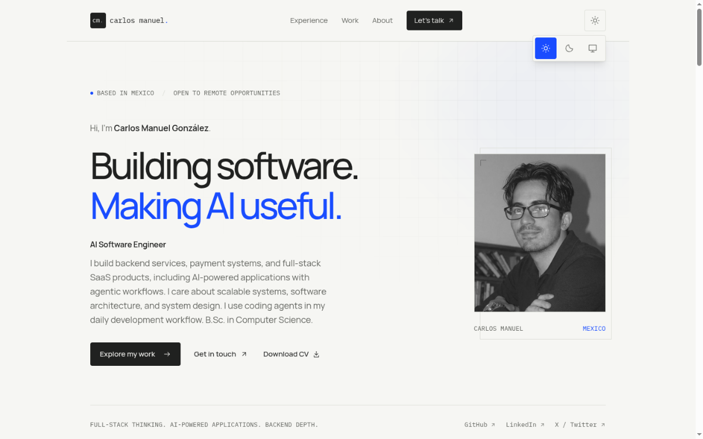
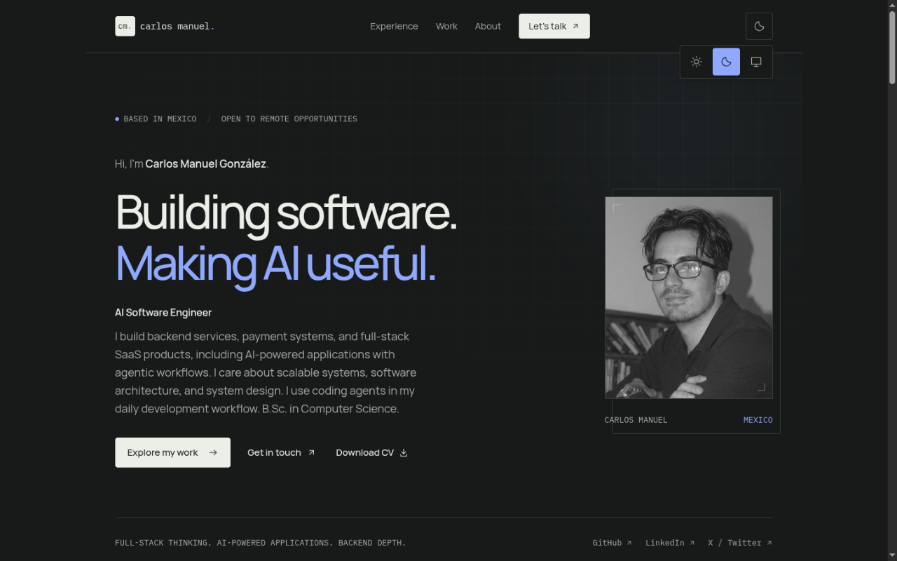
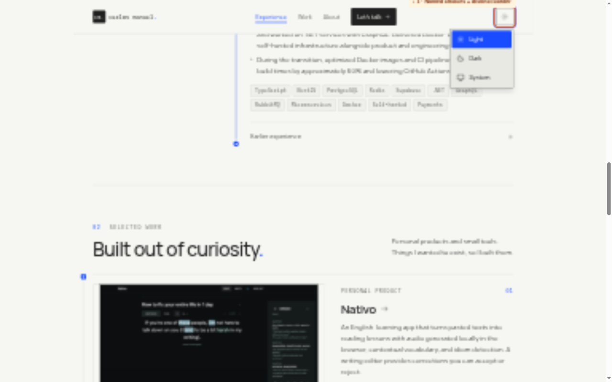
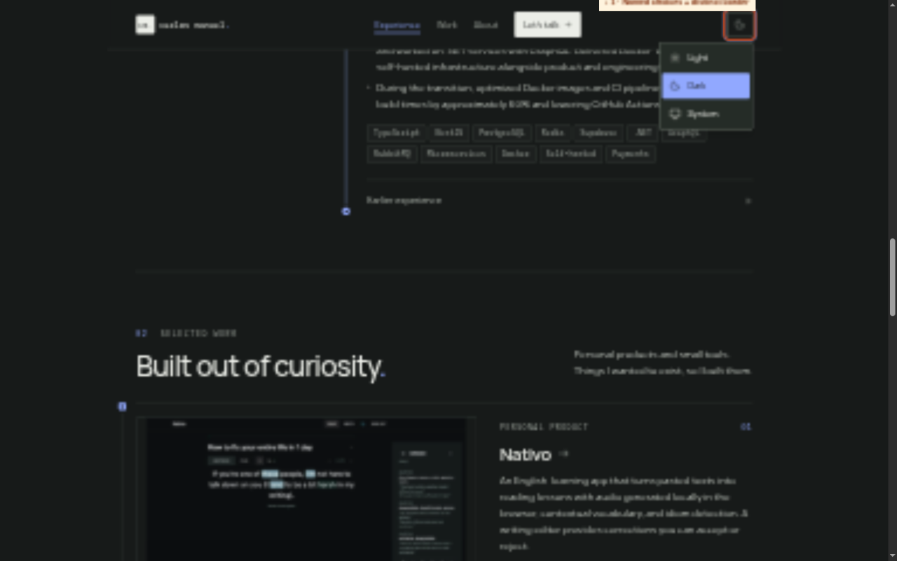
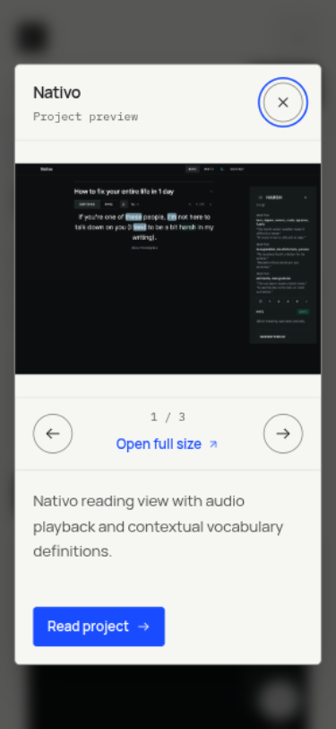

# Portfolio theme review

Base: `feat/theme-selector` at `14adb25`. Fixes: `fix/theme-review-polish`.

## Review cycle

Two independent initial reviews used the requested Sonnet 5.5 high and GPT 6.1 high models. Both inspected the source and computed contrast, but the server was unavailable during that round. Sonnet scored 7.8/10; GPT scored 8.5/10. Their full reports are preserved in this directory. Scores use contrast 30%, consistency 20%, typography 20%, interaction/accessibility 20%, and presentation/naming 10%. The second round scored 7.7 from Sonnet and 9.3 from GPT. Sonnet caught a color/font-size utility collision during the first pass; GPT found stale active-navigation state. Both issues were fixed. Sonnet acceptance reached 9.5/10, rounded from 9.46, on commit 434988f. GPT acceptance also reached 9.5/10, raw 9.52, on the same implementation commit 434988f. Scores describe the version each reviewer inspected, not a certification.

## Findings and changes by area

| Area | Light and dark review | Change and reason |
| --- | --- | --- |
| Palette | Ink, muted, accent, and accent-button text already pass 4.5:1. Dark buttons correctly use dark text on pale blue. | Preserve these pairs. Add copy and edge tokens for separate purposes. Their names avoid collisions with typography utilities. |
| Header | Muted and blue have similar luminance in either theme. A blue active label alone is weak state feedback. | Underline the current section and clear stale state on return to the hero; use a forward arrow for contact navigation; increase its target to 44px. |
| Theme selector | Icon-only choices make System hard to discover. The same-background popup and faint border are particularly weak in dark mode. | Visible Light/Dark/System labels, surface fill, stronger control border, native summary semantics, current preference in accessible name, close on focus leaving. Hide unavailable choices without JS. |
| Hero | Manrope has a clear personality but tight tracking crowds display letters. Role title was smaller than body copy. | Loosen tracking, increase role size to 18px, use a mail icon for email. Preserve portrait and source colors. |
| Experience | Gray prose has less emphasis than metadata needs; role headings rely heavily on weight. | Body contrast increases to 8.18:1 light and 10.60:1 dark; 18px role titles sit above 17px body. Progress marker centers use on-accent rather than fixed white. |
| Work cards | “Photos” is inaccurate for UI assets; OpenWhispr's banner is not a screenshot. Internal titles use an external-arrow icon. | Neutral “Project preview” and “images”; forward-arrow icons; project names in repeated Explore link accessible names. |
| Project details | Long paragraphs can fill a wide desktop column. Gray body text is tiring for case-study reading. | Cap the content column at 65ch and use the new copy token. Add active section feedback. Standardize LinkSeek spelling to its product UI. |
| Gallery dialog | Fixed 60dvh image space wastes room on phones. Control borders are faint in both themes. | Stable 35dvh mobile image area capped at 18rem, desktop sizing preserved, stronger borders, readable descriptions. Preview triggers become image links progressively enhanced into a modal. |
| About | Body and metadata previously share a color. Capability headings are smaller than body. | Stronger body color and role-heading size; preserve the two-column structure. |
| Contact/footer | Email uses the external-link icon; long footer text needs readable contrast. | Mail icon and body token. Small links underline on hover. |
| 404 | Shares the palette correctly; home CTA corners differ from other buttons. | Match the existing rounded button treatment and body contrast. |
| Motion | Some decorative arrow transforms ignore reduced-motion preference. | Guard these transforms with motion-safe and disable CSS transition durations under reduced motion. |

## Contrast verification

Run `node scripts/check-theme-contrast.mjs`. It reads actual CSS tokens, calculates WCAG sRGB luminance and fails below the stated thresholds. It also rejects names shared by color and font-size tokens. It does not replace computed-browser checks for overlays or image content. Run scripts/audit-rendered-theme.js in a browser console after choosing a theme to reproduce the rendered text audit. It settles transitions and uses the browser to parse modern CSS color syntax.

| Pair | Light | Dark |
| --- | --- | --- |
| Ink / paper | 14.92:1 | 14.99:1 |
| Body / paper, new | 8.18:1 | 10.60:1 |
| Muted / paper | 5.53:1 | 7.63:1 |
| Accent / paper | 5.51:1 | 7.72:1 |
| On-accent / accent | 5.97:1 | 7.72:1 |
| Control / paper, new | 3.64:1 | 4.30:1 |
| Control / surface, new | 3.23:1 | 3.51:1 |

Decorative line contrast remains 1.25:1 light / 1.59:1 dark. It is deliberately not the interactive control token. White employer-logo tiles preserve original artwork. Product images retain their own colors, including Nativo's dark UI. Automatically dimming or inverting them would misrepresent the projects.

## Browser evidence

`browser-checks.json` preserves the first pass. `computed-checks.json` records the corrected implementation on `/`, all four `/work/` routes, and `/404/`, in light and dark, at actual widths 1200 and 312 CSS px. There were no detected text contrast failures or horizontal overflow in these 24 checks. Computed body text is 17px/28px, controls 15px/22px, role headings 18px/28px. The text audit excludes hidden/decorative content and samples flat/composited ancestor backgrounds; image pixels, gradients, pseudo-elements and hover states still require visual inspection.

Explicit light preference persisted from the homepage to Nativo. Gallery next updated counter, description and full-size URL. Both reviewers verified native Escape, focus restoration and scroll restoration. Background preview tabs throttle frames, which can delay the queued close event and initially show blank lazy images. No Escape workaround was added. Work → top was tested after the navigation fix: Work was active in its section, then no item was active at the hero.

Manrope loaded in the first narrow pass. Loaded images had no detected failures; this is not a claim that every lazy image was loaded. The preview's requested viewport and actual innerWidth sometimes differ, so all records use actual measurements.
`astro check` completed with zero errors, warnings, or hints. `astro build` generated all six pages. The contrast script passes all eight pairs in both palettes.

## Screenshots

Annotations were temporarily drawn over the actual page in the browser and captured as PNGs. They are not shipped UI. Before/after screenshots were captured by the preview tool at slightly different viewport dimensions, so compare the marked design changes rather than pixel alignment.

| Light | Dark |
| --- | --- |
|  |  |
|  |  |

## Remaining verification

Sonnet acceptance passed at 9.5/10, rounded from 9.46. GPT acceptance also passed at 9.5/10, raw 9.52. Automated checks do not establish screen-reader quality, 200% zoom behavior, cross-browser support, or every gallery slide. These limits must remain visible when reporting the final score.

## Iteration history

The first implementation pass used color names body/control that collided with Tailwind font-size roles. This temporarily changed control text color and removed two font-size utilities. The rendered second review caught it. Final names copy/edge fix the cause, and the contrast script now rejects this class of collision. Top-level annotated images show the latest version; reviewer reports preserve findings from earlier revisions. Both second-round reports are preserved here.

The second pass also scopes hover underlines to muted text links, gives preview links aria-haspopup=dialog, includes the visible cm. wordmark in its accessible name, fixes AI capitalization, clears stale current-section state, and applies the section indicator to project pages. Mobile image space is stable across slides, smaller than the original 60dvh allocation.

## Third review and follow-up

Sonnet scored the third revision 9.3/10. Its full report is sonnet-third.md. The color/size collision, rendered text contrast, theme persistence, stable image area and focus restoration passed. The follow-up makes the header and desktop project navigation sticky, with responsive anchor offsets; it preserves Ctrl/Cmd/Shift/Alt clicks on image links, uses copy color for the hero lead, and reserves space for gallery descriptions to reduce shifting. The scroll check measured the desktop header at top 0, bottom 85px, with the Work section at 104px and its active indicator visible. Modified-click checks confirmed none of the four modifiers was intercepted. Sonnet acceptance verified these fixes and scored 9.5/10, rounded from 9.46. The phone header remains tall at 141px, and very short phone viewports scroll the modal. These are documented tradeoffs.

Sonnet acceptance report: [sonnet-acceptance.md](sonnet-acceptance.md).

## Final result

Both requested models, at high effort, accepted implementation commit 434988f at 9.5/10 to one decimal. Sonnet's raw score is 9.46; GPT's raw score is 9.52. Published commit metadata differs because publication used the connected GitHub API; the reviewed source files are identical. Subsequent changes add reports and screenshots only.

| Reviewer | Initial | Second | Third | Acceptance |
| --- | --- | --- | --- | --- |
| Sonnet 5.5 high | 7.8 | 7.7 | 9.3 | 9.5, raw 9.46 |
| GPT 6.1 high | 8.5 | 9.3 | 9.5 | 9.5, raw 9.52 |

[GPT acceptance report](gpt-acceptance.md) and [Sonnet acceptance report](sonnet-acceptance.md) document exactly what was tested. GPT found no confirmed actionable defect. Its dark-phone anchor retest was inconclusive after browser timeouts; this state must not be counted as independently passed. The short-phone header and scrollable modal remain documented tradeoffs. Neither score certifies full accessibility conformance.

PR: https://github.com/cmglezpdev/portfolio/pull/4, targeting feat/theme-selector. The PR description contains the changes, validation, score history and annotated screenshots.

## Changed source files

| File | Purpose |
| --- | --- |
| [global.css](../../src/styles/global.css) | Copy/edge colors, role sizing, underlines, reduced motion and header anchor offsets. |
| [ThemeSelector.astro](../../src/components/ThemeSelector.astro) | Visible option names, popup fill/border, native summary and no-JS visibility. |
| [ThemeScript.astro](../../src/components/ThemeScript.astro) | Announce current preference, reveal available controls, close on focus leaving. |
| [Header.astro](../../src/components/Header.astro) | Sticky navigation, accessible wordmark, larger contact target and internal arrow. |
| [interactions.ts](../../src/scripts/interactions.ts) | Accurate section tracking and progressive image-link behavior with modifier preservation. |
| [PreviewDialog.astro](../../src/components/PreviewDialog.astro) | Strong control borders, stable mobile image region and reserved description height. |
| [ProjectCard.astro](../../src/components/ProjectCard.astro) | Accurate image labels, internal arrows, named Explore links and image-link fallback. |
| [index.astro](../../src/pages/index.astro) | Readable prose and hero lead, type spacing, mail icon and motion-safe arrows. |
| [work/[slug].astro](../../src/pages/work/[slug].astro) | 65ch prose, sticky section navigation, preview links and consistent typography. |
| [Footer.astro](../../src/components/Footer.astro) | Mail icon, readable prose and motion-safe transform. |
| [404.astro](../../src/pages/404.astro) | Readable prose and matching button corners. |
| [portfolio.ts](../../src/data/portfolio.ts) | LinkSeek and AI capitalization. |
| [check-theme-contrast.mjs](../../scripts/check-theme-contrast.mjs) | Rerunnable palette thresholds and color/font-size collision check. |
| [audit-rendered-theme.js](../../scripts/audit-rendered-theme.js) | Browser text contrast, font-size and overflow evidence. |
