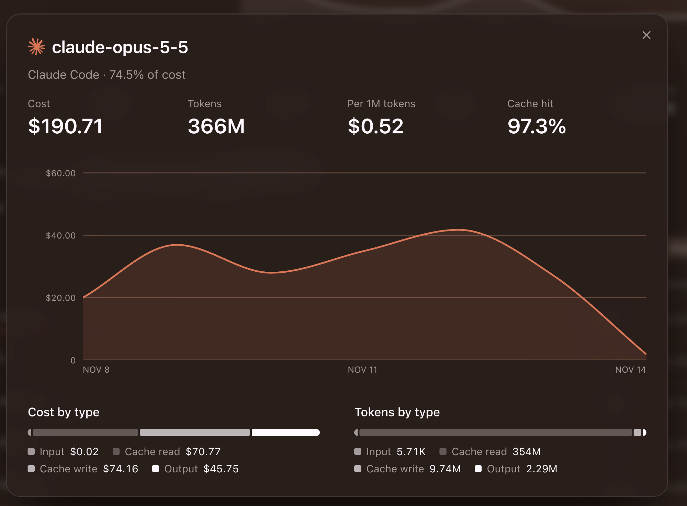
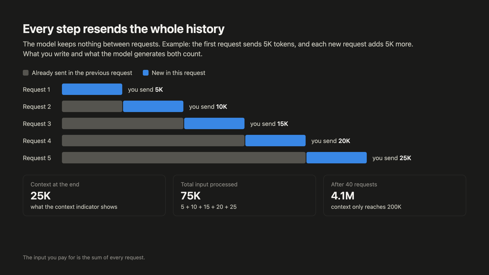
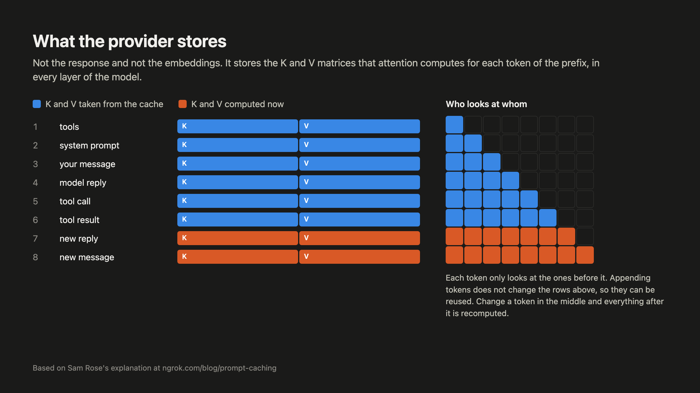
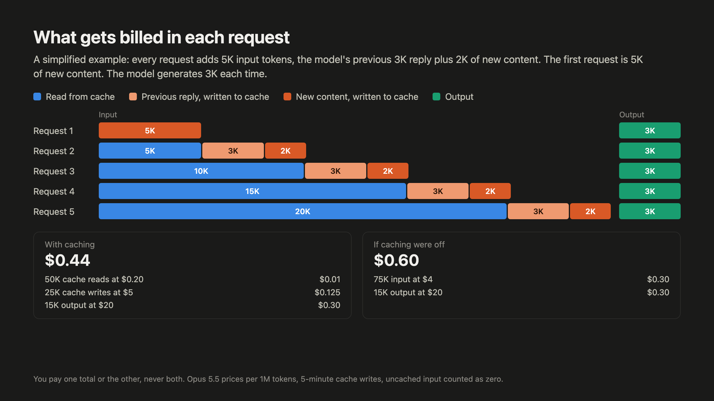
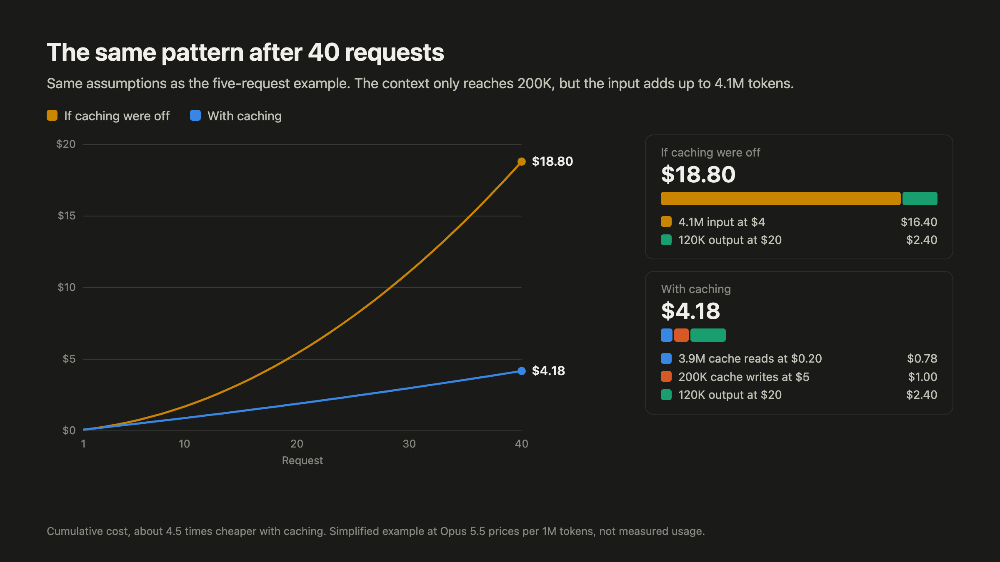
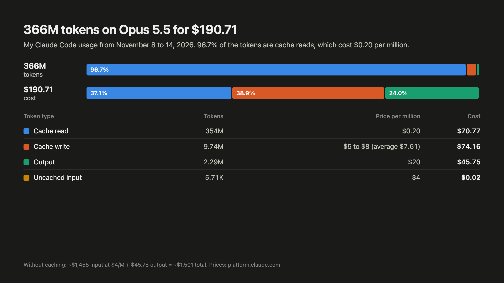

A few months back, I built my first agent at my old job. I saved the messages in a database and started checking how many tokens each request used.

One request used about 7K tokens. Another used 9K. Later, I saw 150K. I wondered, “WTF is all this?” I had barely written anything.

Now I'm building my own agent again, and I want to explain how usage adds up and what happens when you put a price on it.

From November 8 to 14, I used 366M tokens with Opus 5.5 through Claude Code. I pay $20 a month for my subscription. T3 Code estimated that week's usage at $190.71 at API list prices.

*My Opus usage for November 8 to 14, as reported by T3 Code.*

How do 366M tokens on Opus come to just $190.71, when Opus output costs $20 per 1M tokens? The answer starts with the loop around the model.

## One message can start dozens of requests

An **agent** combines a model with code that manages the conversation and runs tools. Those tools might read files, search documents, query a database, or execute commands.

But the model can't execute the tools itself. It only tells your code: "please, run these tools for me and give me the results to continue working."

Suppose you ask a coding agent to fix a failing test. The model may first ask for a file search. Your code runs the search and sends the results back. The model then asks for a file, proposes a change, and asks to run the test.

The loop keeps going until the model gives a final response, or the agent hits a limit, runs into an error, or needs your input.

You only wrote one message, but your code called the model again every time it sent tool results back. Each of those calls is a **request**, so one message from you can trigger five, thirty, or even more requests.

And each of those requests carries the whole history with it.

## The history travels with each request

The model remembers nothing between one request and the next. Each time you call it, you send the whole conversation: the *system prompt*, tools, your messages, its replies, and the results of every tool it ran.

After a tool runs, its result gets added to the end of the history. On the next request, the model receives everything before it again, plus the new result. When you send another message, it also goes to the end of the same history.

A file the agent read ten requests ago counts toward the input of each of the ten requests that followed, as long as it stays in the context.

Here's a simplified example. The first request sends 5K tokens, and each new request adds another 5K. After five requests:

- Context at the end: 25K.
- Input tokens processed: 5K + 10K + 15K + 20K + 25K = 75K.

Those 25K tokens are the input for the last request, the number your *context indicator* shows. The 75K is the total input across all five requests, including the history sent over and over.

*Gray is what was already sent in the previous request. Blue is what's new.*

The gap grows quickly in longer conversations. After 40 requests, the context only reaches 200K, but the total input is 4.1M.

Real conversations add different amounts at each step, and agents can shorten their history or replace older messages with a summary. But the pattern is the same: most of the input in every request is content the model has already received.

Without caching, all of it would be billed as normal input. Opus 5.5 charges $4 per 1M input tokens, so those 4.1M tokens would cost $16.40, and $15.60 of that would pay for content the model had already received.

So how do you stop paying full price for the same content?

## How to pay less for the repeated history

Processing input is work for the provider: it has to run every token through the model. But most of each request was already processed moments ago. If the provider keeps part of that work, it doesn't have to do it again. That's **prompt caching**.

It's possible because of how an LLM reads text. It reads tokens in order, and each token can only look at the tokens before it. That's how **attention** works, the mechanism at the core of LLMs.

Because of that, adding text at the end doesn't change anything that was computed for the earlier tokens. The provider can store part of that computation, called **keys and values** (the **KV cache**), and reuse it when a later request starts with exactly the same content.

The new tokens at the end still have to be processed, and they use the stored keys and values to look at everything before them. The repeated beginning doesn't have to be processed again.

*Blue is the computation reused from the earlier beginning. Orange is the new content added at the end. The small grid shows which earlier positions each token can look at.*

The match has to be exact. If something changes near the beginning, everything after that point has to be processed again.

Sam Rose's [explanation of prompt caching at ngrok](https://ngrok.com/blog/prompt-caching) covers the architecture in detail, including the operations behind keys and values.

An agent conversation fits this well: each request repeats the previous one and adds new content at the end. That means less work for the provider.

Less work doesn't automatically mean a lower price, but Anthropic does charge less for it: reading from the cache costs $0.20 per 1M tokens, while normal input costs $4.

## Input comes with several different prices

Anthropic splits input into *uncached input*, *cache writes*, and *cache reads*. *Output* has its own rate. These are the [Opus 5.5 API list prices](https://platform.claude.com/docs/en/about-claude/pricing), checked on November 14, 2026, in US dollars per 1M tokens.

| Category               | What the charge covers                            | Price per 1M |
| ---------------------- | ------------------------------------------------- | -----------: |
| Uncached input         | Input processed without a cache read or write     |           $4 |
| Cache write, 5 minutes | Input processed and stored for reuse              |           $5 |
| Cache write, 1 hour    | Input processed and stored with a longer lifetime |           $8 |
| Cache read             | Input whose cached computation is reused          |        $0.20 |
| Output                 | Tokens the model generates, including reasoning   |          $20 |

Input includes instructions, tool definitions, tool results, earlier replies, and what you type. In an agent like Claude Code, almost all of it goes through the cache: new content is written once, and later requests read it.

A cache write replaces the normal input charge. You don't pay $4 to send a token and then $5 to cache it. At the 5-minute rate, you pay $5.

A few tokens usually stay uncached. Anthropic's docs say those are the tokens after the last point marked for caching, but I don't know exactly what they are in my case. In my week, they were 5,710 out of 366M, so I'll count them as zero in the examples below.

One piece of text can still be charged in different ways over time. A generated reply is output. When you send it back on the next request, it's a cache write. After that, every request reads it from the cache.

Let's put prices on the earlier example. These numbers are made up to keep the math easy, so I'm assuming:

- The first request sends 5K tokens of new content.
- Every later request adds 5K input tokens: the model's previous 3K reply plus 2K of new content.
- The model generates 3K tokens on every request.
- Cache writes use the 5-minute rate, and every request finds the previous content in the cache.
- Nothing gets compacted or removed from the history.

*Each row is one request. The two totals are alternatives: about $0.44 with caching or $0.60 with caching off. You only pay one of them.*

Five requests only cost cents, so let's keep the same assumptions for 40 requests. The context reaches 200K, the input adds up to 4.1M tokens, and the model generates 120K tokens.

*The cost of the same simplified conversation as it grows, with caching on or off. This is not measured usage.*

With caching, 3.9M tokens are reads ($0.78), 200K are writes ($1.00), and 120K are output ($2.40). That's $4.18. With caching off, the 4.1M input tokens cost $16.40, plus the same $2.40 of output. That's $18.80, about 4.5 times more.

Caching doesn't change the output price. The whole saving comes from the input, which drops from $16.40 to $1.78.

With Anthropic's API, you choose what to cache with *cache-control breakpoints* in the request. Agents like Claude Code do it for you. A cache entry expires if no request uses it within its lifetime. The [prompt-caching documentation](https://platform.claude.com/docs/en/build-with-claude/prompt-caching) explains the details.

## Where my 366M tokens went

Now the week's breakdown makes more sense:

- 354M cache reads: $70.77.
- 9.74M cache writes: $74.16.
- 2.29M output: $45.75.
- 5,710 uncached input: $0.02.

The token counts are rounded, so multiplying them by the rates gives slightly different costs.

*The same weekly figures as the T3 Code screenshot. The two bars compare each category's share of tokens with its share of the cost.*

Cache reads were 96.7% of all tokens, at $0.20 per 1M. That's why the average came down to $0.52 per 1M, even with output at $20.

Cache writes matter too. They were only 2.7% of the tokens, but they cost a bit more than all the reads together. That's what you pay when the agent adds a lot of new content or has to rebuild the cache.

Without caching, every input token would be billed as uncached input at $4 per 1M. That's about $1,455 for input, plus the same $45.75 for output: around $1,500 in total. Caching made this week almost eight times cheaper.

## The token count isn't the bill

So how do 366M tokens on Opus come to $190.71? Most of them were history the model had already received, billed at $0.20 per 1M.

Most of the money went elsewhere. Cache writes and output were 3.3% of my tokens and 63% of the cost.

That doesn't make it cheap. $190 is still a lot for a week of usage. If you're building an agent, track cache reads, cache writes, output, and uncached input separately, because the total alone won't tell you what you're paying for.

That's what I was missing when I first saw 150K tokens tied to a message in my database. A few lines in the chat could trigger many requests, and each one brought the earlier conversation along. The number looked huge, but it couldn't tell me what I was paying for until I knew how those tokens were billed.
